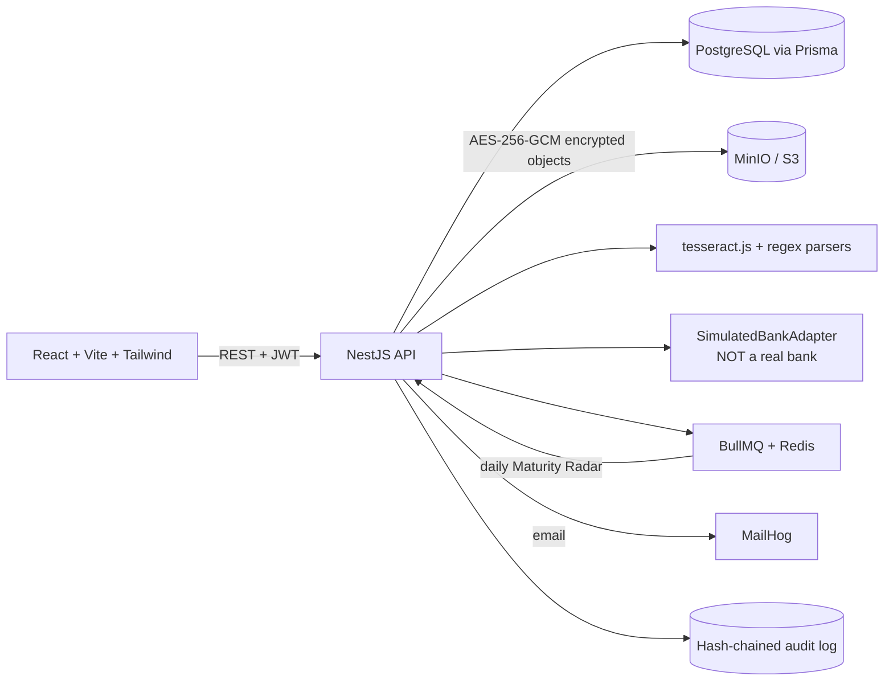

# JaanchSetu: FDR / security deposit lifecycle (SIH 2026, SIH26265)

> **Prototype for SIH 2026. Not an official AICTE system. No real bank integration.** All institutions, banks, people and documents are fictional.

JaanchSetu manages each FDR end to end: **submit → extract → verify → track → renew → release**, with every action in a tamper-evident audit trail.

## The honesty rule

An uploaded file, OCR text, or matching typed values **never** prove an FDR is genuine. Only an authorised bank source can. No real bank is connected here, so:

- Every key field shows where its value came from: **Read from document (OCR)** (blue, with its confidence), **Bank-confirmed (simulation)** (amber) and **Officer-reviewed** (grey). The institution only uploads the document, so the submitted value is the one read from it; a value the institution had to type (unreadable) or changed is flagged. Each is stored with who or what set it. Only the amber source is a bank; there is no generic green "Verified" tick.
- Bank confirmation comes only from a labelled simulator (`SimulatedBankAdapter`). The real route would be an authorised bank API or RBI's consent-based Account Aggregator framework. **That route is not implemented.**
- An officer's manual review is recorded as an action on the field. It does not upgrade the field to bank-confirmed.
- There is no generic green "Verified" tick anywhere. Every page carries the prototype footer.

## Run it

**Everything in Docker (one command):**

```bash
docker compose up --build
```

Open http://localhost:8080. The backend creates the schema and seeds demo data on first start. MailHog (caught emails): http://localhost:8025. MinIO console: http://localhost:9001 (minioadmin / minioadmin).

**Local development** (infrastructure in Docker, apps on your machine; Node 20+):

```bash
npm run setup   # installs, starts postgres/redis/minio/mailhog, pushes schema, seeds
npm run dev     # API on :4000, web on :5173
npm run seed    # reset to the small demo data (5 institutions, 26 FDRs) at any time
npm test        # unit tests (38)
```

**No Docker (Windows):** double-click `start.bat`. It starts an embedded PostgreSQL, applies the schema (new tables are added automatically), seeds on first run and opens the app.

## Testing

```bash
npm test                       # 76 unit tests: rules, OCR parser, audit chain, maker-checker, bank adapters, coverage, release orders
npm run seed && npm run dev    # then, in another terminal:
npm run test:e2e               # 303 end-to-end checks against the running API
```

`test:e2e` signs in as every role and drives the real workflows: submit, OCR, review, bank check, discrepancies, accept, Maturity Radar with the demo clock, reminders and the email outbox, renewal, maker-checker release / refund, admin tools, reports, scoping and the audit chain. It includes a **multiple-institutions** section: three new institutions each submit their own FDRs, and the test proves each one sees only its own FDRs, dashboard counts, reports, documents and reminders, while the officers see all of them, and that the same FDR number or file from two institutions is flagged. It creates test records, so run `npm run seed` afterwards to reset.

**At the scale of the real problem:** `npm run seed:scale` adds 5,000 institutions and 8,000 FDRs (about 11 seconds). On that data every list is paged in the database: a page of FDRs takes 20-50 ms, the dashboard about 250 ms, every report under 100 ms. The Maturity Radar checks 4,900 FDRs in 0.6 s when nothing is due, and sends about 1,700 first reminders in about 35 s. Run `npm run seed` to return to the small demo data.

Copy `.env.example` to `.env` to override defaults. Without Redis the scheduler falls back to an in-process timer; `STORAGE_DRIVER=local` keeps encrypted files on disk instead of MinIO.

## Connecting a bank

By default bank answers come from a **labelled simulator** and every value is shown as "Bank-confirmed (simulation)". To use a real authorised bank (or aggregator) API, set `BANK_API_URL` (and `BANK_API_KEY`). The app then calls it instead, and labels values with `BANK_API_NAME` (never as a simulation). The contract is documented in `backend/src/domain/bank-adapter.ts`:

```
POST {BANK_API_URL}        Authorization: Bearer {BANK_API_KEY}  (also sent as X-API-Key)
{ "fdrNumber": "FDR123", "ifsc": "SBIN0001234", "amount": 1000000, "maturityDate": "2026-11-10" }
-> 200 { "found": true,  "record": { fdrNumber, bankName, branch, ifsc, amount, issueDate, maturityDate, depositorName, inFavourOf } }
-> 200 { "found": false }   (a 404 means the same)
```

Any network error, timeout, non-2xx status or unreadable body is reported as "service unavailable"; the app never guesses an answer. To try it locally without a bank: `node backend/scripts/mock-bank-server.mjs`, then start the API with `BANK_API_URL=http://localhost:4100/verify`. That mock is **not a bank**. A real connection needs a formal agreement and credentials from a bank, which this prototype does not have.

## Email

Every reminder and escalation email is kept in **Admin > Email outbox** (status *recorded*, *sent* or *failed*), so nothing is lost with no mail server. Set `MAIL_DISABLED=false` and `SMTP_HOST`/`SMTP_PORT` (plus `SMTP_USER`/`SMTP_PASS`/`SMTP_SECURE` for a real provider) to actually send. With Docker, MailHog catches them at http://localhost:8025.

## Demo logins (password `demo123`)

| Login | Role |
|---|---|
| institution@demo.test | Institution user (submits, requests renewal/release, sees only its own records) |
| scrutiny@demo.test | Scrutiny Officer, the **maker** |
| approver@demo.test | Approving Officer, the **checker** |
| admin@demo.test | Admin: users, reminder rules, demo clock, audit trail |

A role switcher in the top bar (demo mode) signs you in as any of them. In-app **Demo guide** page has one-click links to the seeded record for each scenario.

## The six scenarios

1. **New FDR submission** (institution): *Submit FDR* → "Matching sample" or "Mismatching sample" → submit. OCR fills the Extracted column, the truth table appears.
2. **Validity tracking:** dashboard counts the seeded FDR as Active; detail page shows days to maturity.
3. **Approaching maturity** (admin): *Admin → +30 / +60 / +90 days* on the 95-day FDR. Reminders fire at 90/60/30/7, status becomes Expiring soon; an unacknowledged reminder escalates every 7 days (institution → scrutiny → approver). A "Demo date" banner is shown. Check Notifications and MailHog. *Reset to real date* rewinds.
4. **Renewal** (institution, then scrutiny): request renewal on the matured FDR → upload renewed FDR → scrutiny accepts → old becomes Renewed; one timeline shows the chain.
5. **Discrepancy identification** (scrutiny): the seeded FDR has an amount mismatch (₹50,000) and an invalid IFSC. Resolve one with a note, waive the other with a written reason, confirm/correct extracted values, accept.
6. **Authorised release:** institution requests → scrutiny ticks the 4-item checklist (each with a note) and recommends → approver approves/rejects with a reason. The API refuses an approval by the maker, the requester or the FDR creator (covered by unit tests). Release is blocked while any discrepancy is Open. Every step appears under *Audit trail*.

Bank simulator results: seeded FDRs exist for MATCH, MISMATCH, NOT_FOUND and SERVICE_UNAVAILABLE ("Check with bank (simulation)" as scrutiny).

## Architecture



Key code: `backend/src/domain/` is pure logic with the unit tests (state machine, discrepancy rules, OCR parser, audit chain, maker–checker, bank adapter). `fdrs/`, `radar/`, `release/` are the services around it.

## How requirements are met

- **Provenance of every value:** `FdrField` keeps the value read from the document, any value the institution entered or changed, the bank answer and the officer's review side by side; the truth table highlights differences in words ("The institution entered ₹5,00,000 but the document reads ₹4,50,000").
- **Smart Extract + Match:** PDF/JPG/PNG up to 10 MB (type checked from file bytes); SHA-256 stored; duplicate hash and duplicate FDR number flagged; the 9 discrepancy types, each with plain-English reason and Open/Resolved/Waived (waiving needs a written reason). Officer must confirm or correct every extracted value before accepting. OCR confidence shown per field.
- **Maturity Radar:** 13-state machine rejecting invalid moves; BullMQ daily job; admin-configurable thresholds and escalation period; demo clock; notification centre + MailHog.
- **Maker–checker:** enforced server-side (`domain/maker-checker.ts`): the checker cannot be the maker, the requester or the record's creator.
- **Audit:** each entry hashes (previous hash + data); *Verify chain integrity* recomputes it. No delete API, and a database trigger rejects UPDATE/DELETE. To demo tampering: `ALTER TABLE "AuditLog" DISABLE TRIGGER audit_immutable;` then edit a row and verify.
- **Verification status:** each FDR shows Pending, Bank-confirmed (simulation, or the bank API's name) or Discrepancy / rejected, as a column, a filter and a dashboard count. It is never a bare "Verified" tick.
- **Reports:** six ready-made reports (pending verifications, upcoming maturities, missing documents, cases needing intervention, institution summary, coverage gaps), each paged on screen and downloadable as CSV.
- **Dashboard:** institution, pending-verification and bank-confirmed tiles, recent alerts, and a **Measured impact** panel computed live from the system's own records (turnaround, discrepancies caught automatically, reminders sent and acknowledged, automated actions). In this prototype the records are demo data, so it shows what the portal measures, not a real before-and-after study.
- **Many institutions:** Admin > Users & institutions has a **CSV import** (name, city, state, optional email). Thousands of rows are sent in batches of 200; duplicates and invalid rows are skipped with a reason; a row with an email also gets an institution login with a random temporary password, shown once for download. Every institution only ever sees its own records.
- **Continuous Coverage Guard:** an admin sets the security deposit each institution must keep (Admin > Users & institutions, or an optional `required` CSV column). The portal compares it with the deposits actually held (accepted, not yet matured), day by day, and warns before a gap opens: OK, Watch (gap within a year), At risk (gap within 90 days) or Shortfall now. Dashboard tile "Coverage at risk", an Institutions panel with a timeline chart, an institution's own cover card, and a "Coverage gaps" report.
- **Verifiable release / refund order:** approving a release issues an order (PDF with decision, reason, maker and checker, QR code and hash). The hash is anchored in the audit chain; anyone can scan the QR to open the public page `/verify/<order no>`, which shows minimal non-sensitive details and re-checks the order against the audit trail. It proves the order matches this prototype's own records, not an official AICTE document. Set `PUBLIC_URL` so the QR points at your deployed address.
- **Upload-only submission:** an institution attaches the scanned receipt and the portal reads it straight away (nothing is saved yet) and fills in the details, showing each value with its OCR confidence and warnings such as a duplicate file. The person can correct any value, or must type the ones that could not be read. The values read from the scan are submitted as the institution's, so there is no typed-versus-scan comparison at submission; the officer still confirms or corrects every value, and only the bank check can confirm a value.
- **Languages:** English, Hindi, plus Tamil and Marathi (beta, core screens only). Picker in the header and on the login page; the choice is remembered. Untranslated text falls back to English. Long help text and server error messages stay in English. Translations are not reviewed by native speakers, so check them before real use.
- **Resolution cases (renewal / release):** the FDR keeps its financial status; a separate case records what is being done about a matured or maturing deposit. Each case has a reason, assigned officer, due date, evidence checklist, approval history and an append-only event timeline (OPEN, evidence, verification, approval, execution, completed; plus blocked, rejected, cancelled). The **Resolution** tab on the FDR page shows days past maturity, the checks (document on file, no open discrepancies, bank-confirmed, labelled "(simulation)" while the bank is simulated) and role-specific actions. Approval needs the checks to pass; the admin policy `PATCH /api/resolution-policy` can relax the bank requirement, and approval re-checks the live record. A renewal completes only when the renewed FDR is linked and accepted; a release only after the maker-checker release order exists plus a recorded acknowledgement. One active case per FDR is enforced by a database index, state changes are version-checked (two simultaneous approvals: one wins), requests accept an `Idempotency-Key` header, and refused attempts are written to the audit trail.
- **Post-maturity milestones and maturity risk:** the Maturity Radar also announces, once each, 1, 7 and 30 days past maturity for deposits with no completed disposition, and a missed case deadline. The dashboard has a "Matured, unresolved" tile and a **Maturity risk** panel (age bands, cases by state, average time to complete). The 1/7/30-day steps and age bands are proposed operating defaults, not statutory deadlines.
- **Admin:** add institutions and users, reset passwords, activate or deactivate, search and page the user list, change reminder rules, drive the demo clock and read the email outbox.
- **Security:** RBAC on every route, institution scoping, bcrypt (bcryptjs), JWT with expiry, login rate limit, class-validator DTOs, files encrypted at rest and served only through an authorised API.

## Known limits (prototype)

- OCR reads images; a scanned PDF with no text layer is not OCR'd (an officer keys values in). OCR can misread (for example `O` vs `0`); that is why officer confirmation is mandatory.
- Bank answers come from the simulator unless a bank API is configured (see "Connecting a bank"); no real bank is connected in this prototype.
- A very large demo-clock jump at 8,000 FDRs sends thousands of notifications and can take about a minute; the normal daily run is quick.
- Not hardened for production (default secrets, in-memory login limiter).
